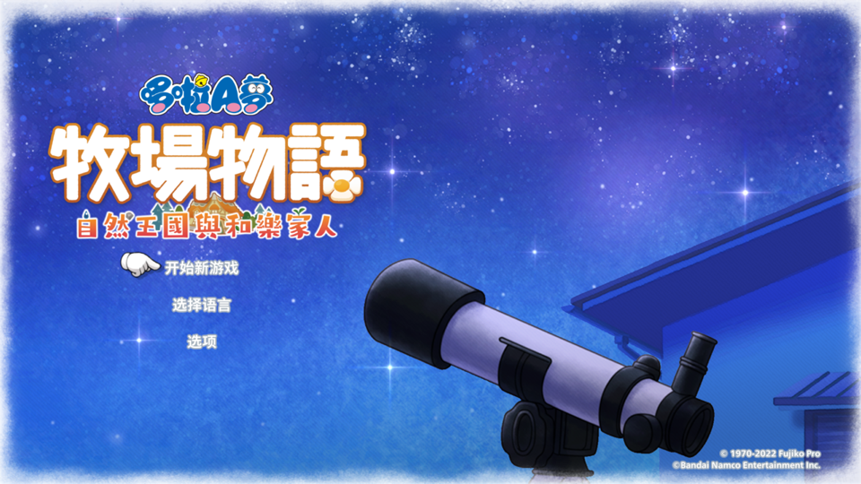
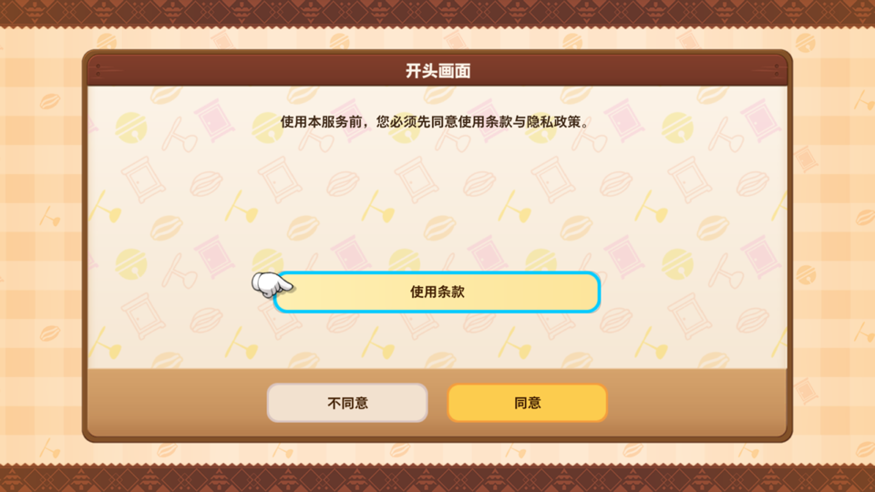
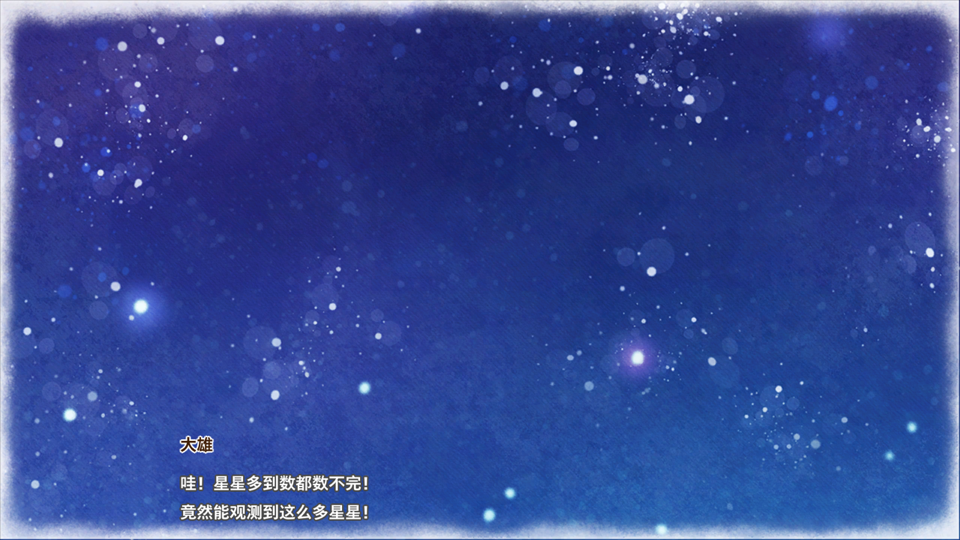

# MacNativePorts

Native runtimes for Nintendo Switch games on Apple silicon. Not an emulator: each game's own ARM64
code runs directly on the chip — rewritten only where the operating system forbids what the console
allowed — while the Switch's system services are answered by a small macOS host and its NVN graphics
are rebuilt on Metal.

One repository, several games. A game brings its differences; the host is shared.

## Legal

**You must own the game.** Use this project only with a copy you bought, and with keys and system
files dumped from your own console. This is an independent, non-commercial project. It is not
affiliated with, endorsed by, or sponsored by Nintendo. Nintendo Switch is a trademark of Nintendo,
and every game named here is the property of its publisher.

The repository contains no game content and distributes none: no game program, art, text, audio,
shaders or keys. Everything a game needs is made on your own computer from your own files. The
runtime you build contains the game, so it is for your own use only; do not share it.

## Games

| Code | Game | State | Verified up to |
|---|---|---|---|
| `dora` | Doraemon Story of Seasons: Friends of the Great Kingdom<br><sub>哆啦A梦 牧场物语 自然王国与和乐家人 · `0100F5E0177AC000`</sub> | playable to the opening | title → terms → save → opening → Nobita runs out of the house |

`games.json` holds the same list in machine-readable form, including what has *not* been verified.
For `dora` that is the 3D world: terrain, shadows, transparency and post-processing have not been
looked at yet.

| | | |
|---|---|---|
|  |  |  |
| title screen | terms of use | opening, under the stars |

## How it works

```
        the game's own ARM64 code  (rewritten, then run natively)
                     │  svc · Horizon IPC · NVN
        ┌────────────┴─────────────┐
   shared/runtime              shared/gfx
   Horizon host                NVN on Metal
   services, FS, threads,      command recording and
   audio, input, loader        replay, textures, shaders
        └────────────┬─────────────┘
                  macOS · Metal
```

Three layers, and the boundary is what makes this a multi-game project:

- **`shared/runtime/`** — the Horizon OS host. Filesystem, IPC services, threads, audio output,
  gamepad and keyboard, and the NRO/NSO loader. It has no knowledge of any particular game beyond
  which services exist.
- **`shared/gfx/`** — NVN translated to Metal: the command buffer is recorded as `OP_*` records and
  replayed into Metal encoders, textures are described by their NVN descriptors, shaders are
  translated through `totk_xlate` and `spirv-cross`. Derived from `d2r_gfx`, MIT.
- **`games/<code>/`** — one game. Its `runtime/` is an **overlay**: a file of the same name replaces
  the shared one, everything else comes from `shared/runtime` untouched.

`dora` compiles 44 source files: 20 of its own plus 26 shared ones it does not touch. The 20 replace
12 shared files and add 8 that exist only for this game (`dora_fs_ext.c` for the `nn::fs` surface
Unity uses, `dora_nvn.c` for the one NVN entry Unity calls that the shared layer does not route,
and so on).

## Build

Requires Xcode Command Line Tools (`xcrun clang`) and Python 3. Nothing else — no Homebrew
packages, no emulator, no SDK.

You need your own copy of the game and your own `prod.keys`.

```bash
# 1. Rewrite the game's ARM64 code with MacNativeGames' build_app.py and put the result here:
#      <work>/20_rewritten/{main,sdk,subsdk0,rtld}      <work>/10_extracted/exefs/   <work>/10_extracted/romfs/
#    The game's own overlay declares where <work> is (see games/dora/game.mk, GAME_WORK).

# 2. Bind the loader to that verified data — modules, symbols, relocations, RomFS index, fonts.
make prepare GAME=dora

# 3. Build and run.
make runtime GAME=dora
make boot GAME=dora
```

`make prepare` checks every input against `games/<code>/assets/expected-*.json` (sizes and SHA-256)
before it writes anything, so a stale or half-written rewrite cannot reach the loader.

## Adding a game

The short version: copy `games/dora/` as a template, change `game.mk`, and add the game's own
header overrides one build error at a time. Most games need far less than `dora` did, because most
of what the host answers is the same everywhere.

`docs/adding-a-game.md` walks through the five stages — container and ExeFS, the ARM64 rewrite and
its equivalence check, module and relocation resolution, the filesystem surface, and the first frame
— and says what each stage produces and how it is verified.

## Layout

```
games.json                 the game list, machine-readable
Makefile                   shared build; GAME=<code> selects the overlay
shared/runtime/            Horizon host (MIT, see LICENSE.runtime.txt)
shared/gfx/                NVN on Metal, fork of d2r_gfx (MIT, see shared/gfx/LICENSE.txt)
shared/scripts/            extraction, module mapping, relocation and coverage checks
games/<code>/              one game: runtime/ overlay, assets/, scripts/, game.mk
patches/                   changes this project makes to upstream d2r_gfx, as applied patches
docs/                      porting guide, screenshots
```

## Credits

The rewrite tooling, the Horizon host and the NVN-on-Metal layer come from
[MacNativeGames](https://github.com/ly05010419/MacNativeGames) by ly05010419 and contributors, via
its `by3-port` branch. `shared/gfx` is a fork of `d2r_gfx` from that project.

`d2r_gfx` builds on [deko3d](https://github.com/devkitPro/deko3d) for its NVN surface; shaders are
translated with [SPIRV-Cross](https://github.com/KhronosGroup/SPIRV-Cross). See
`THIRD_PARTY_NOTICES.md`.
